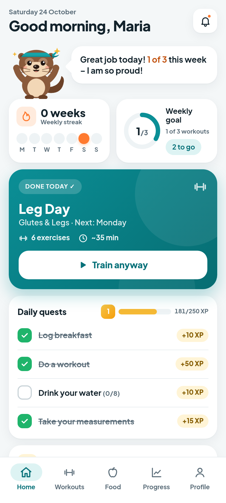

# Vidrichka Fitness 🦦

A personal, offline-first fitness app (PWA). It covers workouts with a rest timer, food logging, progress tracking and motivation from Vidrichka the otter. Everything is stored on your device, with no account and no server. The app speaks English and Bulgarian and has light, dark and auto themes. It is phone-first and installable on iPhone and Android.



## Quick start

```bash
npm ci            # dev tools only — the app itself has zero runtime dependencies
npm start         # http://localhost:8080 (unbundled ES modules, network-first SW)
npm run build     # production build → dist/
npm run preview   # serve dist/ at http://localhost:8080
```

Node ≥ 20 is required.

## Scripts

| script                            | what it does                                                                                                                         |
| --------------------------------- | ------------------------------------------------------------------------------------------------------------------------------------ |
| `npm run lint`                    | ESLint (flat config)                                                                                                                 |
| `npm run format` / `format:check` | Prettier                                                                                                                             |
| `npm run typecheck`               | `tsc` checks the JSDoc types in `src/` (checkJs)                                                                                     |
| `npm test`                        | unit tests (node:test): calories, streaks/freezes, XP/levels, PRs, migrations/backup validation, EN/BG key completeness, recap, data |
| `npm run test:e2e`                | Playwright smoke at 412×915 on Chromium (Android, Pixel 7 UA) and WebKit (iPhone 14); add `-- --shots` to refresh `screenshots/`     |
| `npm run test:e2e:dist`           | build, then run the smoke tests against `dist/` (including the cache-first offline check)                                            |
| `npm run lighthouse`              | Lighthouse (mobile) against `dist/`; reports go to `.lighthouse/`                                                                    |
| `npm run check`                   | lint + format check + typecheck + unit tests + build                                                                                 |

The e2e script uses `/usr/bin/google-chrome` (or `CHROME_PATH`) for Chromium. For WebKit it needs Playwright's build: run `npx playwright-core install --with-deps webkit` once.

## Tech

- Vanilla JavaScript ES modules, HTML and CSS. JSDoc types are checked by TypeScript, and there is no framework.
- IndexedDB, behind an in-memory store with schema versioning and data migrations.
- Hash router with lazily loaded views. esbuild produces code-split, content-hashed bundles.
- Service worker: precaches the built app (cache-first) and shows an update prompt for new versions.
- Plus Jakarta Sans is self-hosted, with a Cyrillic fallback (Manrope) for Bulgarian.
- Open Food Facts handles online food search and barcode lookup. Scanning uses `BarcodeDetector`, a lazily loaded zxing fallback, or a manually typed barcode.

See [docs/ARCHITECTURE.md](docs/ARCHITECTURE.md) and [docs/EXTENDING.md](docs/EXTENDING.md).

## Install on your phone

- **iPhone (Safari):** open the site, tap **Share**, then **Add to Home Screen**. The Profile screen shows these steps too.
- **Android (Chrome):** tap **Install** in Profile, or open the browser menu and choose **Install app**.

## Limitations (honest)

- **Daily reminders (1.2, Web Push):** with **Profile › Reminders › Reminders on this phone** turned on, the push server in [`server/`](server/README.md) (a Cloudflare Worker) sends every daily-rhythm reminder at its local time, even when the app is closed — on iPhone too (iOS 16.4+, Home Screen app). The server only knows a random device id, the push subscription, time zone, reminder times/switches and the notification texts. If the server is unreachable or push is off, the app falls back to the 1.1 local scheduling below.
- **Local fallback (workout reminders, and daily reminders without push):** a web app can't schedule exact alarms on its own. The app uses, best first:
  1. **Notification Triggers** where a browser has them (scheduled ahead, exact). No current stable browser ships them, so this is future-proofing.
  2. **Periodic Background Sync** on installed Android Chrome. The app asks for a check every 15 minutes, but Chrome decides the real interval from how much the app is used — anything from minutes to hours late. The service worker then shows the due reminder and handles **“Yes, I ate”** and **“+1 glass”** buttons without opening the app.
  3. **In-app catch-up:** while the app is open it checks every 30 s (in-app dialogs when on screen, system notifications when in the background), and on every open the latest missed reminder of each kind is shown once. Stale ones (e.g. 11:00 water at 18:00) are dropped.
- **iPhone:** without push, reminders appear only while the app is open or recently used. iOS ignores `silent` (every notification, pushed or not, uses the system sound settings) and has no notification buttons, so tapping a protein/water reminder opens the app with a big Yes / water button instead.
- **Android:** the 7:30 nudge and 22:30 bedtime nudge are `silent`; the 8:15 alarm vibrates and stays until handled (`requireInteraction`). The alarm is skipped when the 7:30 one was tapped or #morning was opened — but only if Android lets the app check in between.
- **Bedtime:** if you forget to say goodnight, bedtime is estimated from the last app use after 20:00 (marked “estimated”); fix it with one tap in the 11:00 check-in.
- **Progress photos (1.2.1):** a photo's default date is its EXIF capture date (JPEG `DateTimeOriginal`, read on the phone). It falls back to the file's date if that is from an earlier day, and otherwise to the upload time. You can always change the date. iOS converts HEIC photos to JPEG when they are picked, and depending on the iOS version the copy can arrive without the capture date. Those photos get the fallback date (this was not tested on a real device). A **monthly 4-pose set** (front, back, left, right) is due from the 1st of each month, with a reminder at 10:00 that day.
- **Voice logging (1.3):** **Say it** turns a sentence into food and water entries with AI. Since 1.3.1 they are saved at once into the meal you named (or the current one), with Undo. Dictation uses the phone keyboard's mic. Only the text, with the local date, time and time zone, is sent to the voice server in [`voice/`](voice/README.md) and on to xAI. The button is hidden until that server is deployed and reachable, and the nutrition values are estimates.
- **Undo, bin, fiber & salt (1.3.1):** every delete or edit shows an **Отмени** snackbar, and deleted things stay 7 days in **Наскоро изтрити** (Profile and the Food diary). Foods can carry optional fiber and salt (manual, Open Food Facts, voice) with daily totals. Meal items can be edited (grams, move to another meal), and saved combinations are one-tap chips in Add food.
- **Undo pill and fixes (1.3.2):** deletions show a small **Отмени** pill for 4 seconds (adds and edits a short toast). Combinations need a unique name and can be renamed; the views refresh right after any change; set weight is capped at 500 kg.
- **Barcode scanning:** needs camera permission and HTTPS.
  - Android Chrome uses the fast native `BarcodeDetector`.
  - iOS Safari has no `BarcodeDetector`, so it uses the zxing fallback. That is slower and needs good light; manual entry always works.
  - Looking a product up needs the internet, and Open Food Facts data quality varies.
- **iOS vibration:** iOS has no vibration API, so the rest timer uses sound. Sound needs the ringer on and is unlocked by your first tap.
- **Storage:** data lives in this browser only. Export a backup now and then; the app reminds you, and photos are included. Persistent storage is requested, but iOS can still clear the data of sites you haven't used for weeks, unless the app is installed to the Home Screen.
- **Calories:** burn is estimated with MET × body weight × time, so treat it as a rough guide.

## Publishing on GitHub Pages

The workflow is in `.github/workflows/deploy.yml`. All URLs are relative, so the app works from `https://<user>.github.io/<repo>/`.

1. Create an empty repository on GitHub (for example `vidrichka-fitness`).
2. `git remote add origin git@github.com:<user>/vidrichka-fitness.git`
3. `git branch -M main && git push -u origin main`
4. In the repository, go to **Settings → Pages → Build and deployment → Source** and choose **GitHub Actions**.
5. The **CI and deploy** workflow runs lint, typecheck, unit tests, build and the e2e smoke tests, then deploys `dist/`. Your URL appears in the run summary and under Settings → Pages.
6. Open the URL on your phone and install it (see above). Later pushes to `main` redeploy automatically, and the installed app shows "Update ready".
